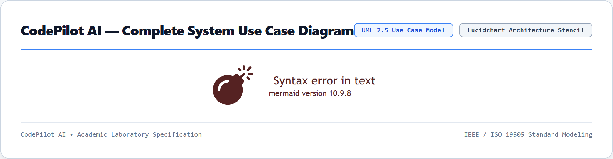

# Assignment 2: Use Case Modeling
**Subject:** Modeling System Requirements Using Use Case Diagrams for Real-World Application  
**Platform / Project:** CodePilot AI (Autonomous AI Software Engineering Assistant)  
**Academic Standards:** IEEE / ISO/IEC 19505:2012 Standard  

---

## 1. Practical Aim & Objectives
This practical lab assignment covers the formal architectural modeling and specification of **CodePilot AI**, focusing on:
- Formal notation comprehension and specification compliance.
- System requirement and structural decomposition modeling.
- Real-world integration with dual student/faculty authentication, multi-agent AST code analysis, and institutional grading.

---

## 2. Description of UML Notations Used
The following UML standard notations are utilized throughout this practical's diagram models:

| UML Notation | Notation Symbol / Visual Element | Technical Definition & Purpose in CodePilot AI |
|---|---|---|
| **Actor (Stick figure / Oval)** | Standard UML Notation | Represents external entities interacting with system (Student Developer, Faculty Evaluator, GitHub API, Supabase). |
| **Use Case (Horizontal Ellipse)** | Standard UML Notation | Specifies a unit of useful functionality delivered by the system to an actor. |
| **System Boundary (Rectangle)** | Standard UML Notation | Defines the scope and boundary of the CodePilot AI platform. |
| **Association (Solid line)** | Standard UML Notation | Communication path linking an actor to a use case. |
| **<<include>> (Dashed arrow)** | Standard UML Notation | Mandatory sub-flow dependency (e.g. Trigger Review always includes AST Parsing). |
| **<<extend>> (Dashed arrow)** | Standard UML Notation | Optional supplementary capability (e.g. Explore Findings extends to Terminal AI chat). |

---

## 3. Diagram Models & Technical Descriptions

### Diagram 1: CodePilot AI — Complete System Use Case Diagram
**Image File:** `Assignment_2_Use_Case_Diagram.png`  
**Classification:** UML 2.5 Use Case Model  

#### Technical Description & Architecture Notes:
Models functional requirements for CodePilot AI. Student Developers authenticate via GitHub OAuth, import repositories or upload ZIP archives, and execute multi-agent reviews. Faculty Evaluators log in via institutional email to inspect cohort defect analytics and grade submissions.

---

## 4. Verification & Submission Files
- **High-Resolution Diagram:** `Assignment_2_Use_Case_Diagram.png` (Rendered at 300 DPI Retina Quality)
- **Document Created:** 17/11/2026
- **Department:** Department of Computer Science & Engineering