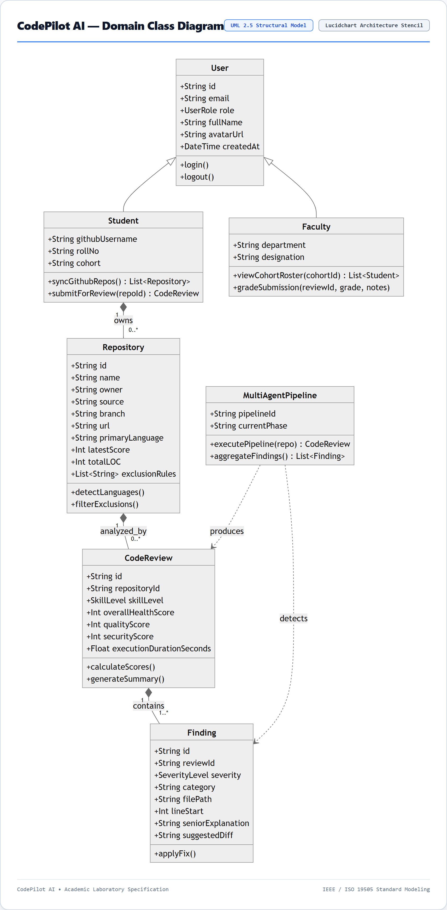
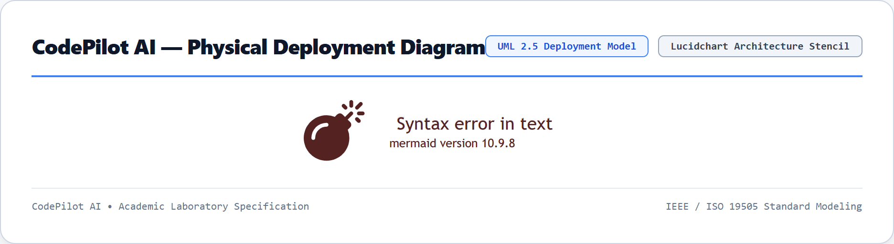
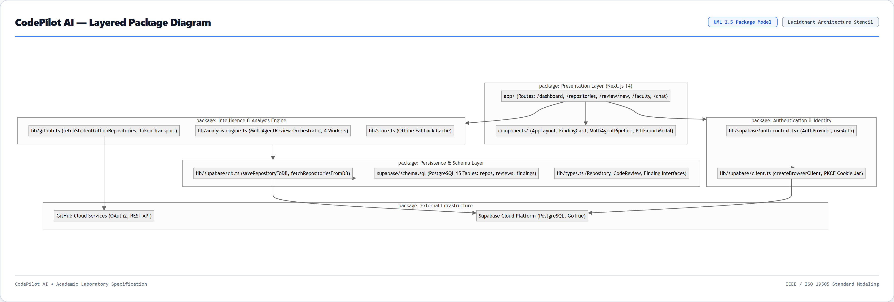

# Assignment 3: Structural Design Modeling
**Subject:** Structural Design Using UML Class, Deployment, and Package Diagrams for Real-World Application  
**Platform / Project:** CodePilot AI (Autonomous AI Software Engineering Assistant)  
**Academic Standards:** IEEE / ISO/IEC 19505:2012 Standard  

---

## 1. Practical Aim & Objectives
This practical lab assignment covers the formal architectural modeling and specification of **CodePilot AI**, focusing on:
- Formal notation comprehension and specification compliance.
- System requirement and structural decomposition modeling.
- Real-world integration with dual student/faculty authentication, multi-agent AST code analysis, and institutional grading.

---

## 2. Description of UML Notations Used
The following UML standard notations are utilized throughout this practical's diagram models:

| UML Notation | Notation Symbol / Visual Element | Technical Definition & Purpose in CodePilot AI |
|---|---|---|
| **Class Box (3 Compartments)** | Standard UML Notation | Top compartment for class name, middle for attributes (+ public, - private), bottom for methods. |
| **Generalization / Inheritance (<|--)** | Standard UML Notation | Indicates is-a relationship where Student and Faculty inherit common User properties. |
| **Composition (*-- )** | Standard UML Notation | Strong whole-part ownership (e.g. Repository owns Reviews; CodeReview owns Findings). |
| **Package Tab Box** | Standard UML Notation | Groups related architectural modules enforcing strict downward dependency flow. |
| **3D Node Box** | Standard UML Notation | Represents computational hardware/infrastructure resources in Deployment diagrams. |
| **Execution Environment** | Standard UML Notation | Software container running application code (e.g. Browser, Node.js runtime). |

---

## 3. Diagram Models & Technical Descriptions

### Diagram 1: CodePilot AI — Domain Class Diagram
**Image File:** `Assignment_3_Class_Diagram.png`  
**Classification:** UML 2.5 Structural Model  

#### Technical Description & Architecture Notes:
Defines the structural blueprint of CodePilot AI across Class models (domain entities and methods), Physical Deployment (browser, Vercel serverless, Supabase PostgreSQL, GitHub API), and Layered Packages (separation of concerns between Presentation, Auth, Engine, and Persistence).

### Diagram 2: CodePilot AI — Physical Deployment Diagram
**Image File:** `Assignment_3_Deployment_Diagram.png`  
**Classification:** UML 2.5 Deployment Model  

#### Technical Description & Architecture Notes:
Defines the structural blueprint of CodePilot AI across Class models (domain entities and methods), Physical Deployment (browser, Vercel serverless, Supabase PostgreSQL, GitHub API), and Layered Packages (separation of concerns between Presentation, Auth, Engine, and Persistence).

### Diagram 3: CodePilot AI — Layered Package Diagram
**Image File:** `Assignment_3_Package_Diagram.png`  
**Classification:** UML 2.5 Package Model  

#### Technical Description & Architecture Notes:
Defines the structural blueprint of CodePilot AI across Class models (domain entities and methods), Physical Deployment (browser, Vercel serverless, Supabase PostgreSQL, GitHub API), and Layered Packages (separation of concerns between Presentation, Auth, Engine, and Persistence).

---

## 4. Verification & Submission Files
- **High-Resolution Diagram:** `Assignment_3_Class_Diagram.png` (Rendered at 300 DPI Retina Quality)
- **Document Created:** 17/11/2026
- **Department:** Department of Computer Science & Engineering