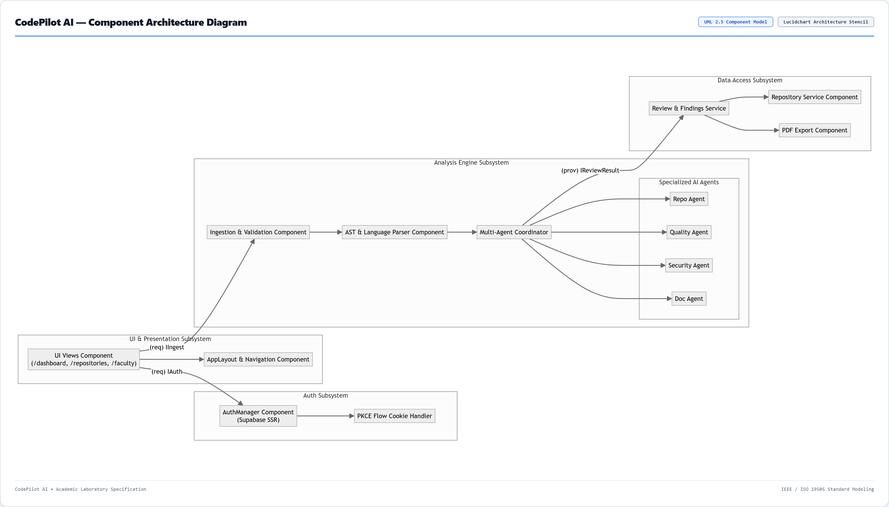
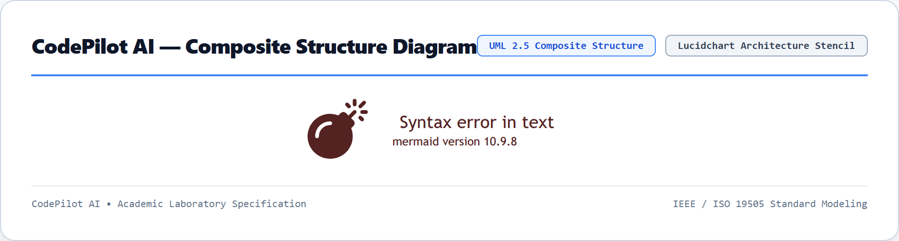
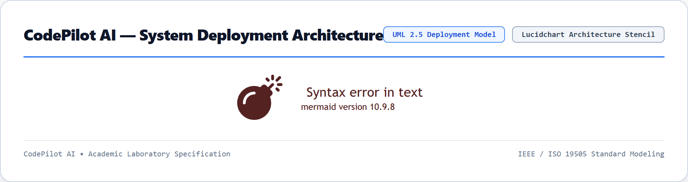
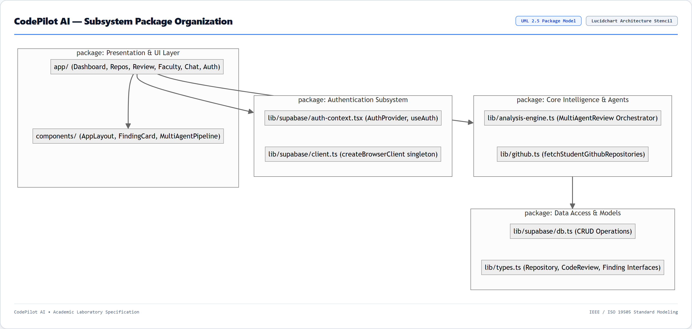

# Assignment 4: System Architecture & Component Design
**Subject:** System Architecture & Design Using UML Deployment, Package, Component, and Composite Structure Diagrams  
**Platform / Project:** CodePilot AI (Autonomous AI Software Engineering Assistant)  
**Academic Standards:** IEEE / ISO/IEC 19505:2012 Standard  

---

## 1. Practical Aim & Objectives
This practical lab assignment covers the formal architectural modeling and specification of **CodePilot AI**, focusing on:
- Formal notation comprehension and specification compliance.
- System requirement and structural decomposition modeling.
- Real-world integration with dual student/faculty authentication, multi-agent AST code analysis, and institutional grading.

---

## 2. Description of UML Notations Used
The following UML standard notations are utilized throughout this practical's diagram models:

| UML Notation | Notation Symbol / Visual Element | Technical Definition & Purpose in CodePilot AI |
|---|---|---|
| **Component Stereotype (<<component>>)** | Standard UML Notation | Modular, encapsulated unit with replaceable internal implementation. |
| **Provided Interface (Lollipop / Circle)** | Standard UML Notation | Services and operations the component offers to other components (e.g. IReviewEngine). |
| **Required Interface (Socket / Semi-circle)** | Standard UML Notation | Services the component requires from other subsystems to execute (e.g. IAuthService). |
| **Classifier (Composite Box)** | Standard UML Notation | Outer composite class encapsulating internal parts and ports. |
| **Port (Small Square Box)** | Standard UML Notation | Interaction point on classifier boundary isolating internal structure from environment (p1, p2, p3). |
| **Internal Part** | Standard UML Notation | Instance playing a specific role within the composite structure. |

---

## 3. Diagram Models & Technical Descriptions

### Diagram 1: CodePilot AI — Component Architecture Diagram
**Image File:** `Assignment_4_Component_Diagram.png`  
**Classification:** UML 2.5 Component Model  

#### Technical Description & Architecture Notes:
Details the modular component decomposition and internal composite structures of CodePilot AI, illustrating how internal workers (Validator, Sanitizer, LanguageEngine, and Parallel Agents) communicate through explicit typed ports.

### Diagram 2: CodePilot AI — Composite Structure Diagram
**Image File:** `Assignment_4_Composite_Structure_Diagram.png`  
**Classification:** UML 2.5 Composite Structure  

#### Technical Description & Architecture Notes:
Details the modular component decomposition and internal composite structures of CodePilot AI, illustrating how internal workers (Validator, Sanitizer, LanguageEngine, and Parallel Agents) communicate through explicit typed ports.

### Diagram 3: CodePilot AI — System Deployment Architecture
**Image File:** `Assignment_4_Deployment_Diagram.png`  
**Classification:** UML 2.5 Deployment Model  

#### Technical Description & Architecture Notes:
Details the modular component decomposition and internal composite structures of CodePilot AI, illustrating how internal workers (Validator, Sanitizer, LanguageEngine, and Parallel Agents) communicate through explicit typed ports.

### Diagram 4: CodePilot AI — Subsystem Package Organization
**Image File:** `Assignment_4_Package_Diagram.png`  
**Classification:** UML 2.5 Package Model  

#### Technical Description & Architecture Notes:
Details the modular component decomposition and internal composite structures of CodePilot AI, illustrating how internal workers (Validator, Sanitizer, LanguageEngine, and Parallel Agents) communicate through explicit typed ports.

---

## 4. Verification & Submission Files
- **High-Resolution Diagram:** `Assignment_4_Component_Diagram.png` (Rendered at 300 DPI Retina Quality)
- **Document Created:** 17/11/2026
- **Department:** Department of Computer Science & Engineering