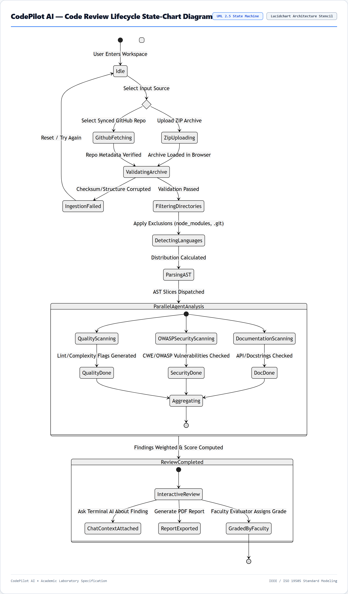
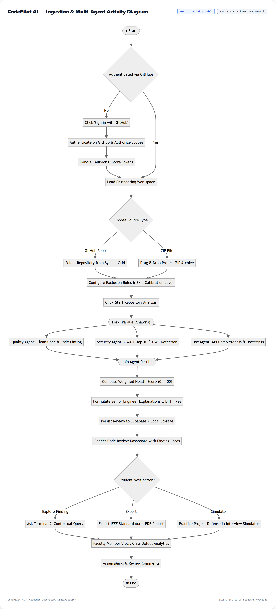

# Assignment 5: Behavioral Design (State-Chart & Activity)
**Subject:** UML State-Chart Diagram and Activity Diagram for Real-World Application  
**Platform / Project:** CodePilot AI (Autonomous AI Software Engineering Assistant)  
**Academic Standards:** IEEE / ISO/IEC 19505:2012 Standard  

---

## 1. Practical Aim & Objectives
This practical lab assignment covers the formal architectural modeling and specification of **CodePilot AI**, focusing on:
- Formal notation comprehension and specification compliance.
- System requirement and structural decomposition modeling.
- Real-world integration with dual student/faculty authentication, multi-agent AST code analysis, and institutional grading.

---

## 2. Description of UML Notations Used
The following UML standard notations are utilized throughout this practical's diagram models:

| UML Notation | Notation Symbol / Visual Element | Technical Definition & Purpose in CodePilot AI |
|---|---|---|
| **Initial Node (Filled Black Circle)** | Standard UML Notation | Starting point of state machine or activity workflow. |
| **State (Rounded Box)** | Standard UML Notation | Condition during the life of an object satisfying conditions or performing activities. |
| **Transition (Directed Arrow)** | Standard UML Notation | Relationship indicating movement from source to target state triggered by an event. |
| **Decision Node (Diamond)** | Standard UML Notation | Branching point with mutually exclusive guard conditions. |
| **Fork Bar (Solid Horizontal Bar)** | Standard UML Notation | Splits single execution flow into multiple concurrent parallel threads. |
| **Join Bar (Solid Horizontal Bar)** | Standard UML Notation | Synchronizes multiple concurrent threads before continuing. |
| **Activity Final Node (Bullseye Circle)** | Standard UML Notation | Termination point of all flows in the activity. |

---

## 3. Diagram Models & Technical Descriptions

### Diagram 1: CodePilot AI — Code Review Lifecycle State-Chart Diagram
**Image File:** `Assignment_5_State_Chart_Diagram.png`  
**Classification:** UML 2.5 State Machine  

#### Technical Description & Architecture Notes:
Captures dynamic system behavior: State-chart diagrams model how repository submissions transition from Idle to Ingesting, Parallel Scanning, Review Completed, and Graded. Activity diagrams illustrate parallel agent execution and decision logic.

### Diagram 2: CodePilot AI — Ingestion & Multi-Agent Activity Diagram
**Image File:** `Assignment_5_Activity_Diagram.png`  
**Classification:** UML 2.5 Activity Model  

#### Technical Description & Architecture Notes:
Captures dynamic system behavior: State-chart diagrams model how repository submissions transition from Idle to Ingesting, Parallel Scanning, Review Completed, and Graded. Activity diagrams illustrate parallel agent execution and decision logic.

---

## 4. Verification & Submission Files
- **High-Resolution Diagram:** `Assignment_5_State_Chart_Diagram.png` (Rendered at 300 DPI Retina Quality)
- **Document Created:** 17/11/2026
- **Department:** Department of Computer Science & Engineering