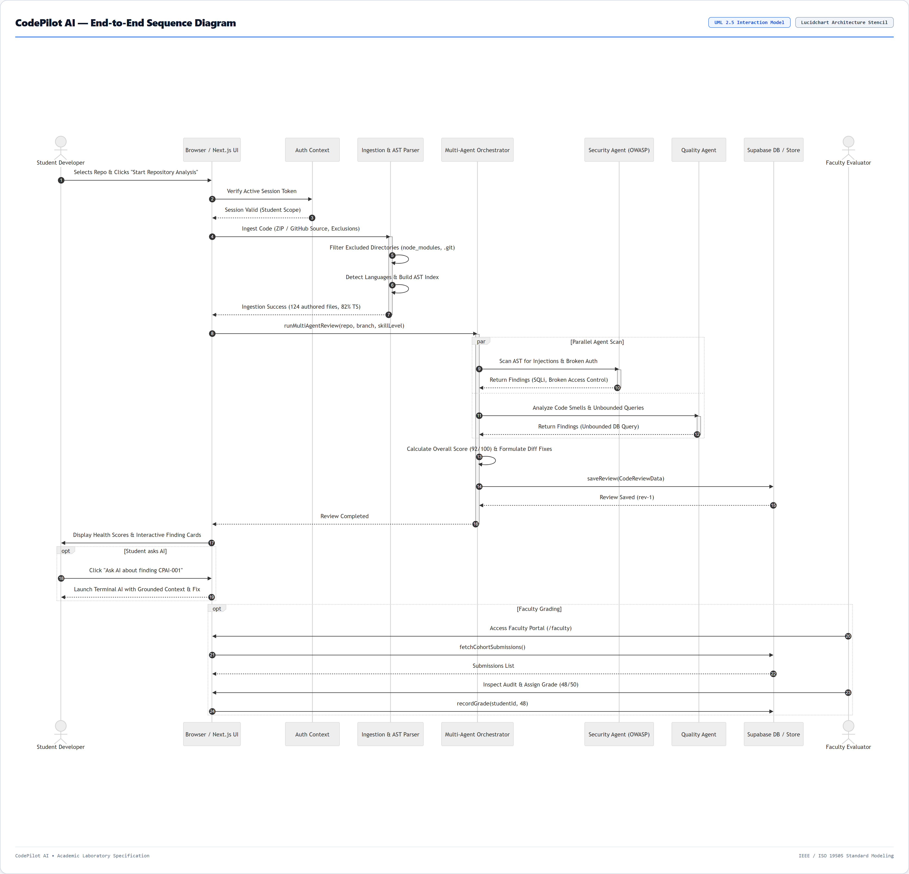
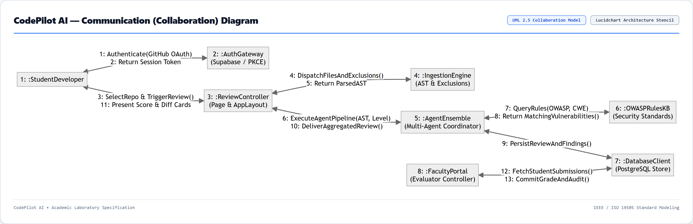

# Assignment 6: Interaction Design (Sequence & Communication)
**Subject:** UML Sequence Diagram and Communication (Collaboration) Diagram for Real-World Application  
**Platform / Project:** CodePilot AI (Autonomous AI Software Engineering Assistant)  
**Academic Standards:** IEEE / ISO/IEC 19505:2012 Standard  

---

## 1. Practical Aim & Objectives
This practical lab assignment covers the formal architectural modeling and specification of **CodePilot AI**, focusing on:
- Formal notation comprehension and specification compliance.
- System requirement and structural decomposition modeling.
- Real-world integration with dual student/faculty authentication, multi-agent AST code analysis, and institutional grading.

---

## 2. Description of UML Notations Used
The following UML standard notations are utilized throughout this practical's diagram models:

| UML Notation | Notation Symbol / Visual Element | Technical Definition & Purpose in CodePilot AI |
|---|---|---|
| **Lifeline (Vertical Dashed Line)** | Standard UML Notation | Represents the existence of an object over time. |
| **Activation Box (Rectangle on lifeline)** | Standard UML Notation | Indicates the period during which an object is executing an action. |
| **Synchronous Message (Solid Line with Solid Arrowhead)** | Standard UML Notation | Caller waits for receiver to finish processing before proceeding. |
| **Return Message (Dashed Line with Open Arrowhead)** | Standard UML Notation | Returns control/result from callee back to caller. |
| **par Fragment Box** | Standard UML Notation | Indicates concurrent parallel executions occurring simultaneously. |
| **Object Role (Box with :ClassName)** | Standard UML Notation | Participant object in communication diagram. |
| **Numbered Message Link** | Standard UML Notation | Sequence numbering (e.g. 1.1, 2.1) indicating chronological message ordering across structural links. |

---

## 3. Diagram Models & Technical Descriptions

### Diagram 1: CodePilot AI — End-to-End Sequence Diagram
**Image File:** `Assignment_6_Sequence_Diagram.png`  
**Classification:** UML 2.5 Interaction Model  

#### Technical Description & Architecture Notes:
Details time-ordered interactions and structural collaborations between the student, browser UI, ingestion parser, parallel agents, and Supabase database. Shows async callback handling and faculty grading feedback loops.

### Diagram 2: CodePilot AI — Communication (Collaboration) Diagram
**Image File:** `Assignment_6_Communication_Diagram.png`  
**Classification:** UML 2.5 Collaboration Model  

#### Technical Description & Architecture Notes:
Details time-ordered interactions and structural collaborations between the student, browser UI, ingestion parser, parallel agents, and Supabase database. Shows async callback handling and faculty grading feedback loops.

---

## 4. Verification & Submission Files
- **High-Resolution Diagram:** `Assignment_6_Sequence_Diagram.png` (Rendered at 300 DPI Retina Quality)
- **Document Created:** 17/11/2026
- **Department:** Department of Computer Science & Engineering