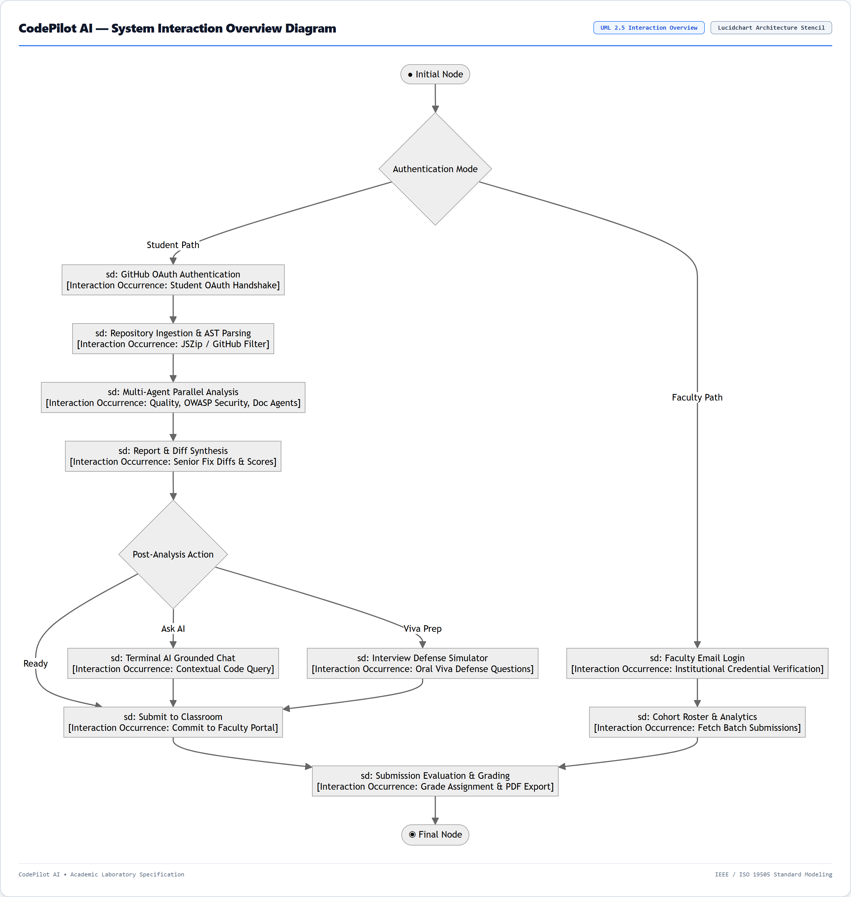

# Assignment 7: Interaction Overview Modeling
**Subject:** UML Interaction Overview Diagram for Real-World Application  
**Platform / Project:** CodePilot AI (Autonomous AI Software Engineering Assistant)  
**Academic Standards:** IEEE / ISO/IEC 19505:2012 Standard  

---

## 1. Practical Aim & Objectives
This practical lab assignment covers the formal architectural modeling and specification of **CodePilot AI**, focusing on:
- Formal notation comprehension and specification compliance.
- System requirement and structural decomposition modeling.
- Real-world integration with dual student/faculty authentication, multi-agent AST code analysis, and institutional grading.

---

## 2. Description of UML Notations Used
The following UML standard notations are utilized throughout this practical's diagram models:

| UML Notation | Notation Symbol / Visual Element | Technical Definition & Purpose in CodePilot AI |
|---|---|---|
| **Interaction Occurrence (ref Frame)** | Standard UML Notation | A box representing an entire encapsulated interaction (Sequence Diagram) embedded inside the overview flow. |
| **Initial Node (Filled Circle)** | Standard UML Notation | Indicates entry point of the interaction overview. |
| **Decision Node (Diamond)** | Standard UML Notation | Directs control flow based on conditions (Student vs Faculty path, Action choice). |
| **Control Flow (Solid Arrow)** | Standard UML Notation | Sequencing link showing transfer of control between interaction occurrences. |
| **Final Node (Bullseye Circle)** | Standard UML Notation | Concludes the entire interaction overview model. |

---

## 3. Diagram Models & Technical Descriptions

### Diagram 1: CodePilot AI — System Interaction Overview Diagram
**Image File:** `Assignment_7_Interaction_Overview_Diagram.png`  
**Classification:** UML 2.5 Interaction Overview  

#### Technical Description & Architecture Notes:
An Interaction Overview Diagram provides a high-level architectural view connecting multiple sequence diagrams into an activity-like flow, highlighting the transition from student OAuth, through AST parsing and multi-agent review, to viva defense and faculty evaluation.

---

## 4. Verification & Submission Files
- **High-Resolution Diagram:** `Assignment_7_Interaction_Overview_Diagram.png` (Rendered at 300 DPI Retina Quality)
- **Document Created:** 17/11/2026
- **Department:** Department of Computer Science & Engineering